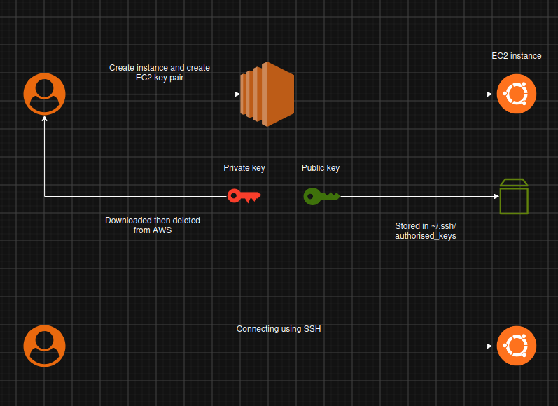

## Day 01 - AWS EC2 Key Pair

Objective: Understand how AWS EC2 key pairs work and how to use them for secure SSH authentication.

**What I learned:**

- Creating an EC2 key pair.
- Understanding public and private keys.
- Downloading the .pem private key.
- Connecting to EC2 instance using SSH.
- Understanding Linux file permissions.
- Using chmod 400 to secure private keys.

**Commands used:**

```
chmod 400 ec2-demo.pem
```

```
ssh -i ec2-demo.pem ubuntu@<EC2-PRIVATE-KEY>
```

**Concepts:**

| Concept | Explanation |
| --- | --- |
| Key pair  | Public and private key combination |
| Public key  | Used by EC2 for authentication |
| Private key | Used by you to authenticate |

