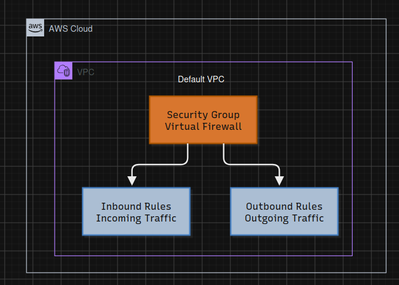

## Day 02 - AWS EC2 Security Group

Objective: Understand how AWS Security Groups work and how to create a Security Group inside the Default VPC to control network traffic.

**What I learned:**

- Creating a Security Group in AWS EC2.

- Selecting the Default VPC.

- Understanding inbound and outbound rules.

- Understanding how Security Groups act as virtual firewalls.

**Concepts:**

| Concept | Explanation |
| --- | --- |
| Security Group | Acts as a virtual firewall for EC2 instances. |
| Default VPC | Default Virtual Private Cloud provided by AWS. |
| Inbound Rules | Control incoming network traffic. |
| Outbound Rules | Control outgoing network traffic. |
| Security Group ID | Unique identifier assigned to a Security Group. |

