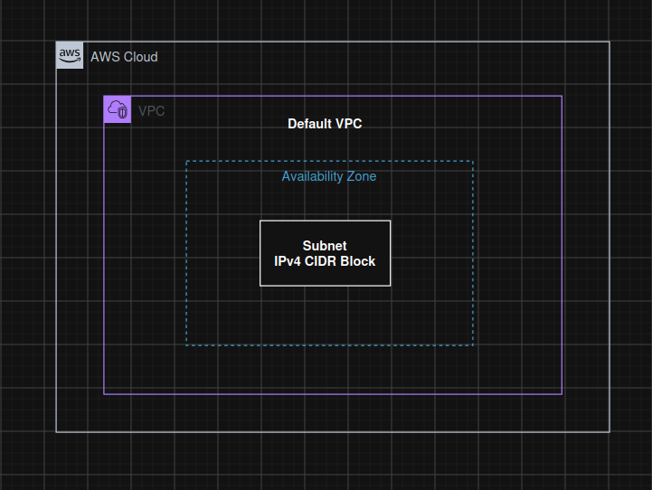

# Day 03 - AWS Subnet Creation

**Objective:** Understand how AWS Subnets work and how to create a subnet inside the Default VPC to organize network resources.

**What I learned:**

- Creating a subnet inside the Default VPC.

- Selecting an Availability Zone (AZ).

- Configuring the subnet IPv4 CIDR block.

- Understanding the relationship between VPCs and Subnets.

**Steps followed:**

1. Navigated to the VPC service.

2. Selected Subnets under Virtual Private Cloud.

3. Clicked on Create subnet.

4. Selected the Default VPC.

5. Entered the subnet name.

6. Selected an Availability Zone.

7. Configured the IPv4 CIDR block.

**Concepts:**

| Concept | Explanation |
| --- | --- |
| VPC | A logically isolated virtual network in AWS. |
| Subnet | A smaller network segment inside a VPC. |
| Default VPC | Default Virtual Private Cloud provided by AWS. |
| CIDR Block | Defines the range of IP addresses available in a network. |
| Availability Zone | An isolated location within an AWS Region. |
| Public Subnet | A subnet with a route to an Internet Gateway. |
| Private Subnet | A subnet without a direct route to an Internet Gateway. |

